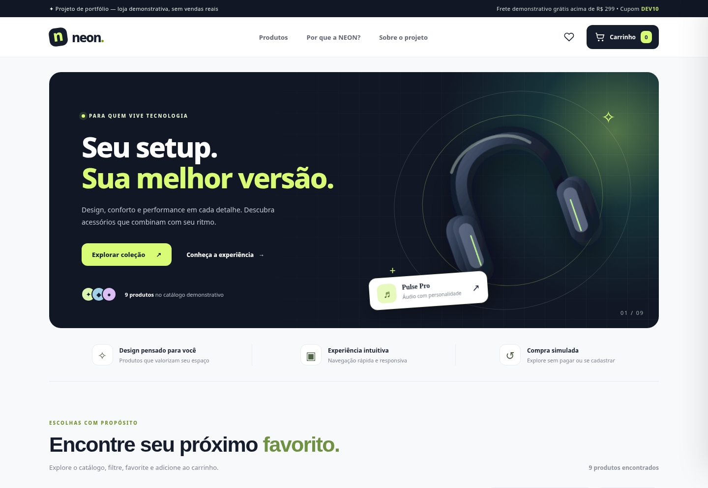

# NEON Store — E-commerce demonstrativo



Uma loja virtual **fictícia** de acessórios de tecnologia feita com HTML5, CSS3 e JavaScript puro. Ideal como exercício de desenvolvimento front-end, publicável gratuitamente no GitHub Pages.

**Aviso:** produtos, avaliações, preços, descontos e frete são fictícios. Não há pagamento, estoque real, autenticação, pedidos reais ou backend. Não use dados pessoais reais no formulário demonstrativo.

## Funcionalidades
- 9 produtos ilustrados com SVGs locais
- Busca, filtros por categoria e ordenação
- Favoritos e carrinho persistidos em `localStorage`
- Quantidades, remoção, subtotal, frete fictício e cupom `DEV10` (10%)
- Checkout demonstrativo validado no navegador, sem envio nem salvamento de dados do formulário
- Modal de detalhes, notificações, atalhos `/` e `Escape`, e layout responsivo

## Tecnologias
HTML semântico, CSS Grid/Flexbox, JavaScript ES6+, manipulação do DOM, eventos, métodos `filter` e `sort`, `localStorage` e SVG.

## Como executar
Abra `index.html` no navegador ou use a extensão Live Server do VS Code. Com Python, execute `python -m http.server 5500` na pasta e visite `http://localhost:5500`.

## Publicar no GitHub Pages
Use o repositório do Thiago no GitHub. Envie **todos os arquivos**, incluindo as imagens `.svg` e `preview.png`, para a **raiz** do repositório. Acesse **Settings > Pages > Deploy from a branch > main > /(root) > Save**. O URL terá o formato `https://thiiaguinho06.github.io/Thiiaguinho06-NEON-Store-E-commerce-de-tecnologia/` após publicar corretamente.

## Estrutura
```
neon-store/
├── index.html
├── styles.css
├── script.js
├── headphones.svg, keyboard.svg e demais imagens .svg
├── favicon.svg
├── preview.png
├── README.md
└── COMO-PUBLICAR.md
```

## Próximos passos para o portfólio
Personalize o visual, altere os produtos, acrescente testes, explique o funcionamento de `localStorage` e da delegação de eventos, e avalie a acessibilidade. Entenda e modifique o código antes de apresentá-lo como trabalho próprio. Seja transparente sobre a origem de um projeto usado como ponto de partida.

Fontes Google são carregadas quando a conexão permite, com fontes de fallback caso contrário. O site não requer banco de dados ou API.
